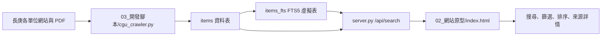

# 長庚校務導航技術架構

## 目前版本

這一版是集中式搜尋 MVP。網站以 SQLite + FTS5 查詢爬蟲資料，先支援關鍵字、單位、文件類型、有效狀態與日期排序；語意查詢目前只保留少量可驗證的意圖規則，尚未引入生成式 AI。

## 技術組成

| 層次 | 技術 | 目前用途 |
|---|---|---|
| 前端 | 純 HTML、CSS、JavaScript | 搜尋頁面、篩選器、結果卡片、來源詳情視窗 |
| API | Python `http.server` | 提供靜態檔案與 `/api/*` 搜尋端點 |
| 資料庫 | SQLite | 儲存 2,784 筆爬蟲資料 |
| 全文搜尋 | SQLite FTS5，`trigram` tokenizer | 搜尋主題、標題、內文、關鍵字、適用對象與單位 |
| 爬蟲 | Python、BeautifulSoup、PDF 文字擷取 | 探索長庚校內網站、整理標準欄位與 PDF 文字 |
| 來源資料 | `cgu_data_with_pdf_text.xlsx`、JSON、CSV | 原始匯出與檢查用途 |

## 系統流程



## SQLite schema

### `items`

主要欄位：

- `unit`
- `subject` / `title`
- `document_type`
- `applicable_audience`
- `keywords`
- `published_date`
- `last_updated_date`
- `original_url`
- `is_valid`
- `pdf_pages`
- `pdf_text`
- `content`

### `items_fts`

這是外部內容 FTS5 表，索引欄位為：

```text
subject, title, content, pdf_text, keywords,
applicable_audience, unit
```

使用 `trigram` tokenizer，適合中文片段搜尋。對於兩字短詞或非連續詞，API 會在 FTS5 沒有結果時使用欄位備援比對，避免「英文免修」這類查詢被 tokenizer 漏掉。

## 搜尋 API

### `GET /api/health`

確認服務與 SQLite FTS5 是否啟動。

### `GET /api/meta`

回傳索引總筆數、含 PDF 文字的筆數、單位清單與文件類型清單。

### `GET /api/search`

支援參數：

```text
q       關鍵字
topic   主題或關鍵字欄位篩選
unit    單位
type    文件類型
valid   yes / no / unknown
sort    asc / desc
```

搜尋回傳文件標題、單位、類型、適用對象、日期、PDF 頁數、文字長度、摘要與原始連結。

## 查詢意圖

目前有一條可驗證規則：

```text
英文免修
→ 英文免修意圖
→ 搜尋「英文」與「免修」
→ 顯示英文課程免修相關文件
```

未來可以把規則表抽成資料表，再加入同義詞、口語問法與意圖分類。生成式回答要等資料內容與來源段落完整後再加入。

## 本機啟動

```powershell
py server.py
```

開啟 `http://127.0.0.1:8765/`。直接用 `file://` 開啟頁面時，前端會使用內嵌資料作為離線備援；使用 `server.py` 才會走 SQLite + FTS5 API。

## 目前限制

- SQLite 資料庫目前是本機檔案，尚未接雲端託管資料庫。
- `is_valid` 大多數資料是 `NULL`，頁面會顯示「待確認」，不自行推定有效性。
- 部分公告與規章沒有可擷取的 PDF 文字，結果仍會保留原始連結。
- `server.py` 是 MVP API，尚未加入登入、權限、排程更新與正式部署設定。
